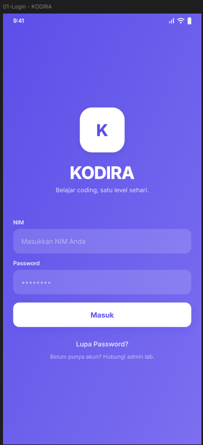
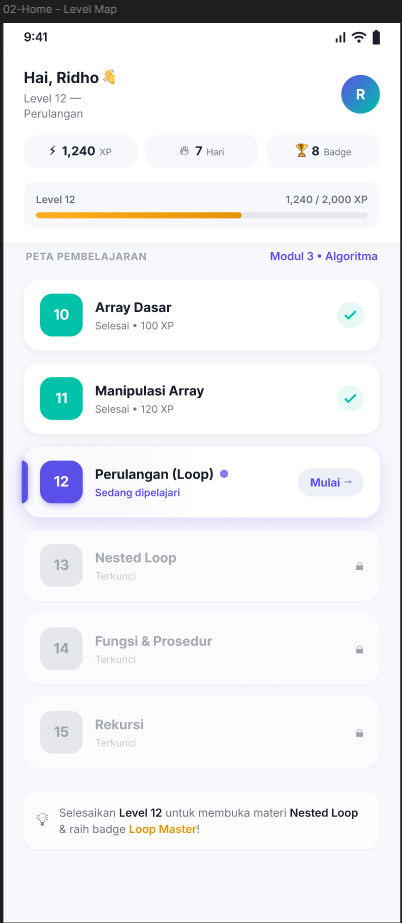
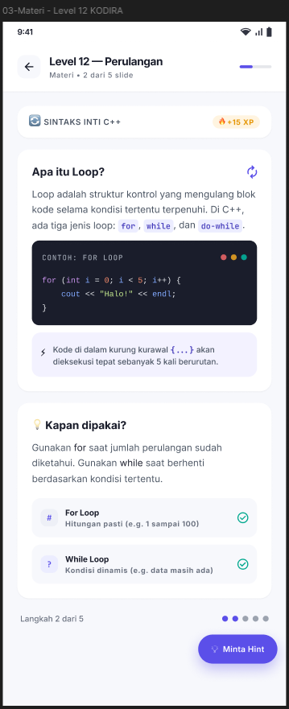
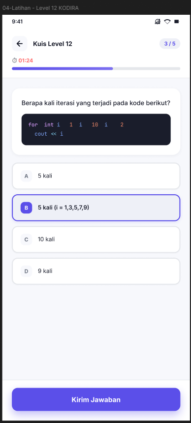
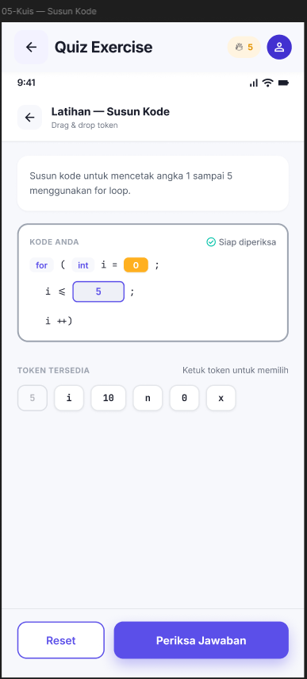
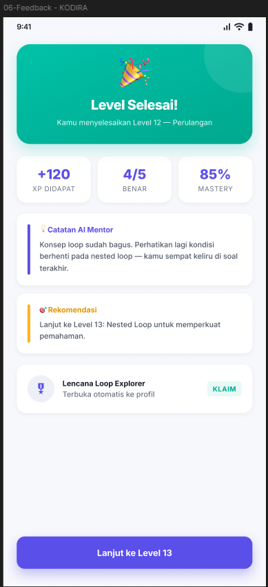
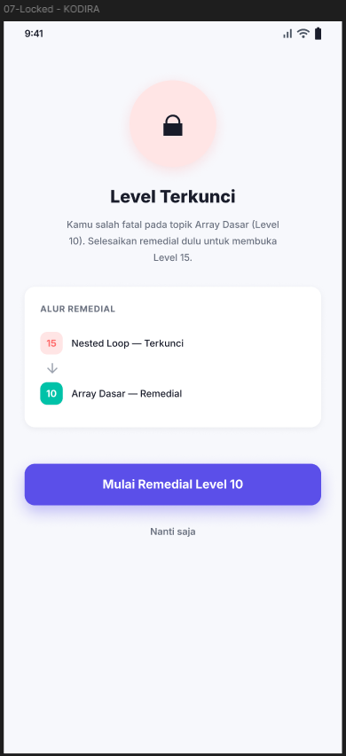
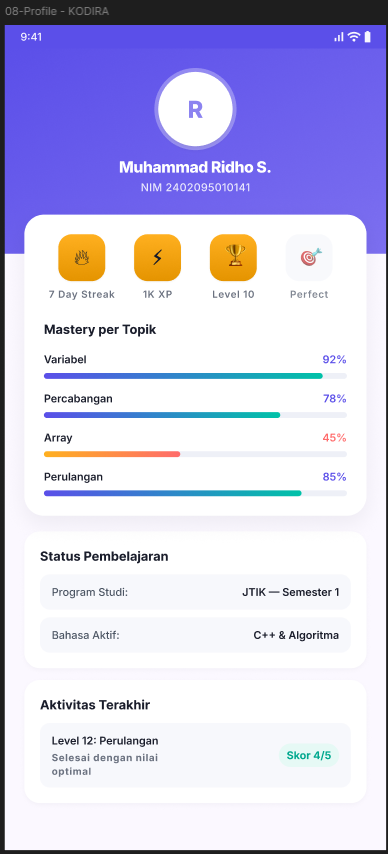

# KODIRA

Aplikasi pembelajaran pemrograman C++ & Java untuk mahasiswa JTIK semester 1. Gamifikasi + latihan interaktif + kuis adaptif.

[]()
[]()
[]()
[]()

---

## Fitur

- 🔐 **Login NIM** — autentikasi Supabase dengan NIM mahasiswa
- 📚 **50 Level Linier** — C++ (level 1–35) + Java (level 36–50)
- 📝 **Materi Interaktif** — 5 slide per level (250 slide total)
- 🎯 **Latihan Drag & Drop** — 5 exercise per level (250 total)
- 🧠 **Kuis Adaptif** — 3 soal pilihan ganda per level (150 quiz)
- ⚡ **XP & Progress** — simpan skor terbaik, unlock level berikutnya
- 🔥 **Streak Harian** — motivasi konsistensi belajar
- 🏆 **Badge & Achievement** — 9 badge + 3 achievement auto-award
- 👤 **Profil Lengkap** — stats, badge, achievement, mastery, aktivitas
- 📱 **Android Native** — Flutter dengan target minSDK 24

---

## Screenshot

### Login & Home



### Pembelajaran




### Progress & Feedback




---

## Stack

| Layer       | Teknologi                          |
| ----------- | ---------------------------------- |
| Mobile      | Flutter 3.44 + Dart 3.12           |
| State       | Riverpod 2.x                       |
| Routing     | go_router 14.x                     |
| Backend     | Supabase (PostgreSQL + Auth + RLS) |
| Test        | 220 unit + widget test (CI hijau)  |
| Architecture| Clean Architecture (feature-first) |
| Decisions   | 24 ADR documented                  |

Detail arsitektur: [`docs/03-architecture.md`](docs/03-architecture.md)

---

## Setup

### Prasyarat

- **Flutter SDK** 3.44+ — [Install](https://docs.flutter.dev/get-started/install)
- **Dart** 3.12+ (bundled with Flutter)
- **Android SDK** — untuk build APK
- **Git** — [Install](https://git-scm.com/)
- **Akun Supabase** — project ref `vnmrivutawqxcoklamcb`

### Development

```bash
# 1. Clone repo
git clone https://github.com/raylienardy/KODIRA.git
cd KODIRA

# 2. Masuk ke folder app
cd app

# 3. Install dependencies
flutter pub get

# 4. Generate code (freezed + json_serializable)
dart run build_runner build --delete-conflicting-outputs

# 5. Setup environment
cp .env.example .env
# Edit .env:
#   SUPABASE_URL=https://vnmrivutawqxcoklamcb.supabase.co
#   SUPABASE_ANON_KEY=<minta ke tim>

# 6. Jalankan di device/emulator
flutter run --dart-define-from-file=.env
```

> **Catatan:** `.env` wajib ada di `app/` untuk development. Secrets tidak dibundle ke APK; untuk build release, inject via `--dart-define` (lihat ADR-024).

### Setup Pre-commit Hook

```bash
# Dari root project
bash scripts/install-hooks.sh
```

Hook otomatis format (`dart format`), analyze (`flutter analyze`), dan rebuild graphify sebelum commit.

### Test

```bash
cd app
flutter test          # 220 test
flutter analyze       # 0 issue
dart format --set-exit-if-changed lib test  # format check
```

### Build Release

```bash
# Split per ABI (arm64-v8a, armeabi-v7a, x86_64) untuk ukuran optimal <50MB
bash scripts/build-release.sh
# Output: app/build/app/outputs/flutter-apk/*-release.apk
```

Detail build: [`docs/03-architecture.md`](docs/03-architecture.md) → Deployment

---

## Struktur Project

```
kodira/
├── app/                           # Kode Flutter (folder utama)
│   ├── lib/
│   │   ├── app/                   # Konfigurasi app, router, theme
│   │   ├── core/                  # Constants, errors, utils
│   │   ├── data/                  # Models, repositories
│   │   ├── features/              # Feature modules (auth, home, quiz, ...)
│   │   └── shared/                # Widgets & providers global
│   ├── test/                      # 220 unit + widget tests
│   ├── supabase/                  # Migrations & seed SQL
│   └── pubspec.yaml
├── docs/                          # Dokumentasi lengkap
│   ├── 00-phases.md               # Roadmap fase
│   ├── 01-prd.md                  # Product requirements
│   ├── 03-architecture.md         # Arsitektur teknis
│   ├── 05-decisions.md            # 24 ADR
│   ├── 07-backlog.md              # 65 task backlog
│   ├── 10-handover.md             # Handover notes
│   └── assets/screenshots/        # 8 screenshot
├── reference/                     # Referensi desain UI
├── scripts/                       # Pre-commit hooks
├── AGENTS.md                      # Instruksi untuk AI agent
├── DESIGN.md                      # Design system (format Stitch)
├── CONTRIBUTING.md                # Panduan kontribusi
└── README.md
```

---

## Dokumentasi

| Dokumen                                                | Deskripsi                                |
| ------------------------------------------------------ | ---------------------------------------- |
| [`docs/00-phases.md`](docs/00-phases.md)               | Roadmap fase pengembangan ADDIE          |
| [`docs/01-prd.md`](docs/01-prd.md)                     | Product requirement & user stories       |
| [`docs/02-design-system.md`](docs/02-design-system.md) | Design system (warna, tipografi)         |
| [`docs/03-architecture.md`](docs/03-architecture.md)   | Arsitektur teknis + API                  |
| [`docs/04-guidelines.md`](docs/04-guidelines.md)       | Konvensi kode & workflow                 |
| [`docs/05-decisions.md`](docs/05-decisions.md)         | 24 Architecture Decision Records         |
| [`docs/06-workflow.md`](docs/06-workflow.md)           | Workflow dengan opencode                 |
| [`docs/07-backlog.md`](docs/07-backlog.md)             | 65 task backlog                          |
| [`docs/08-context-map.md`](docs/08-context-map.md)     | Peta file per task                       |
| [`docs/09-cp-tp.md`](docs/09-cp-tp.md)                 | Capaian & tujuan pembelajaran            |
| [`docs/10-handover.md`](docs/10-handover.md)           | Handover notes untuk developer berikutnya|
| [`AGENTS.md`](AGENTS.md)                               | Instruksi untuk AI agent                 |
| [`DESIGN.md`](DESIGN.md)                               | Design system (format Stitch)            |
| [`CONTRIBUTING.md`](CONTRIBUTING.md)                   | Panduan kontribusi                       |

---

## Roadmap

| Phase | Fokus                             | Status           |
| ----- | --------------------------------- | ---------------- |
| 0     | Foundation                        | ✅ Selesai       |
| 1     | Design System                     | ✅ Selesai       |
| 2     | UI Design                         | ✅ Selesai       |
| 3     | Architecture                      | ✅ Selesai       |
| 4     | MVP Development                   | ✅ Selesai       |
| 5     | AI Integration                    | ⏳ Blocked (backend) |
| 6     | Testing & Evaluation              | ⏳ Pending (Phase 5) |
| 7     | Documentation & Presentation      | 🚧 Dalam proses  |

**Phase 4 MVP Development:** SELESAI (12 Done / 0 Todo / 0 Review / 2 Skip = 14 task)

Detail fase: [`docs/00-phases.md`](docs/00-phases.md)

---

## Kontribusi

Baca [`CONTRIBUTING.md`](CONTRIBUTING.md). Ringkas:

1. Buat branch dari `main` dengan format `feat/<nama-fitur>` atau `fix/<nama-bug>`
2. Kerjakan task dari [`docs/07-backlog.md`](docs/07-backlog.md)
3. Commit dengan format Conventional Commits (`feat:`, `fix:`, `docs:`, `chore:`)
4. Push & buat Pull Request
5. Tunggu review dari teman tim

Pre-commit hook otomatis format, analyze, dan build graphify.

---

## CI/CD

CI otomatis berjalan pada setiap push/PR ke `main` via `.github/workflows/ci.yml`:

- ✅ Format check (`dart format`)
- ✅ Static analysis (`flutter analyze`)
- ✅ Test suite (220 test)

Badge status: 

---

## Tim

**Kelompok 3 — PTIK B 2024**

- Muhammad Ridho Satriadi (2402095010141)
- Raynato Lienardy (2402095010152)

**Dosen Pengampu:**  
Kurnia Wahyu Prima, S.Pd., M.Pd.

---

## Lisensi

Proyek akademik untuk mata kuliah Pemrograman Dasar (JTIK). Tidak untuk distribusi komersial tanpa izin.

---

## Kontak

Ada pertanyaan? Buka issue di GitHub, atau hubungi tim langsung.
