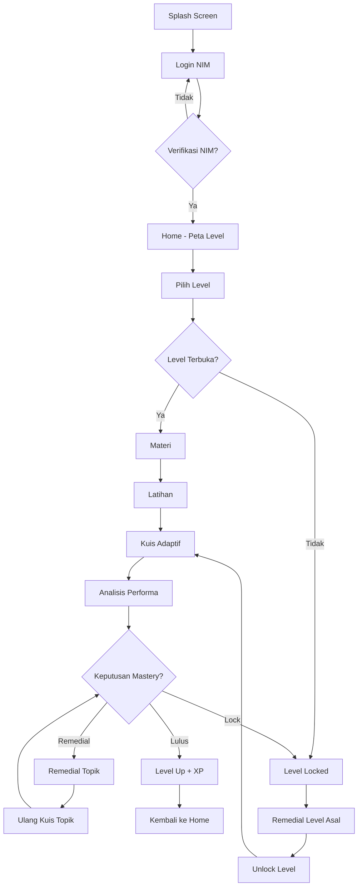
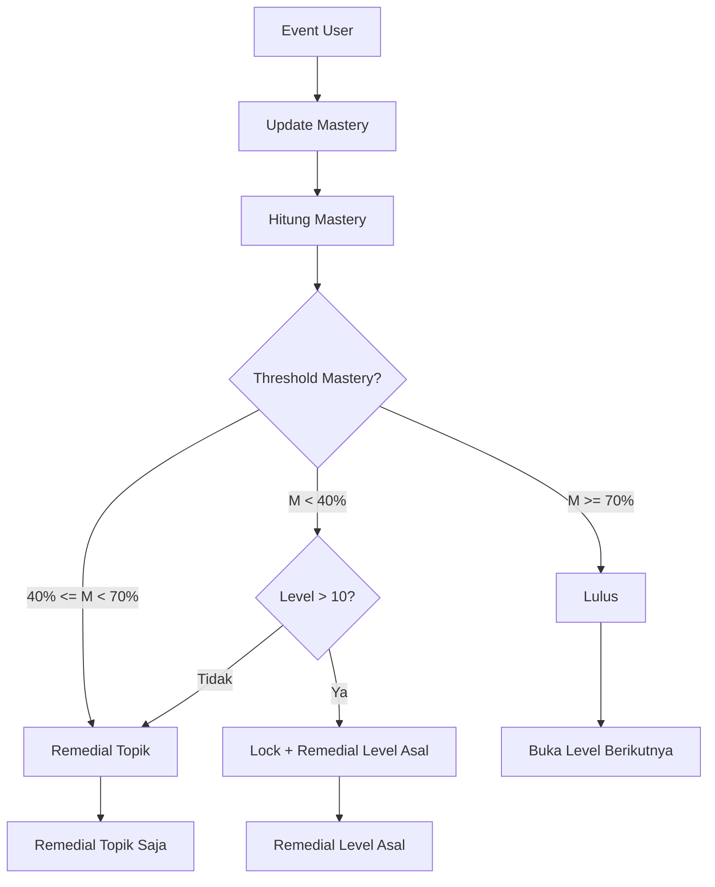
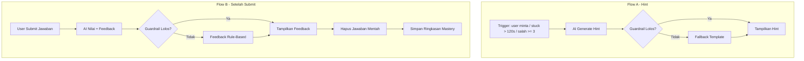
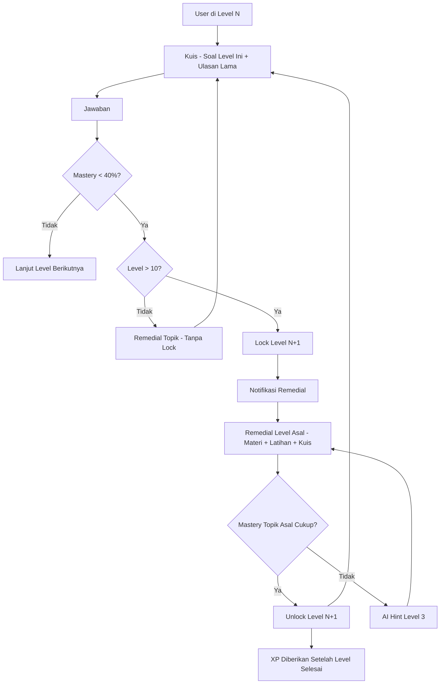

# User Flow Diagram — KODIRA

Diagram alur interaksi pengguna dalam aplikasi KODIRA. Mencakup alur utama, logika adaptive engine, AI hint and feedback, serta mekanisme level locking.

## 1. Alur Utama

Alur utama pengguna dari splash screen hingga kembali ke home setelah menyelesaikan atau remedial level.

## 2. Adaptive Engine

Logika perhitungan mastery dan keputusan unlocking atau remedial berdasarkan event pengguna.

## 3. AI Hint dan Feedback

Dua sub-flow: permintaan hint sebelum submit, dan feedback setelah submit. Keduanya melewati guardrail.

## 4. Level Locking

Mekanisme penguncian level ketika mastery di bawah 40 persen serta proses remedial dan unlock.

